<p align="center">

  

</p>


<h3 align="center">Carry a lantern through the dark forest, catch fireflies, and escape a vampire and a witch. Built from scratch in C++ and OpenGL</h3>


<p align="center">

  <b>Manar Toufique Chowdhury</b> &nbsp;·&nbsp; <b>Fahmina Zannat Khan Zebin</b><br>

  CSE 402: Computer Graphics &amp; Image Processing Lab · Metropolitan University, Sylhet Bangladesh

</p>


<p align="center">

  

  

  

  

  

</p>


<p align="center">

  

</p>


<p align="center">

  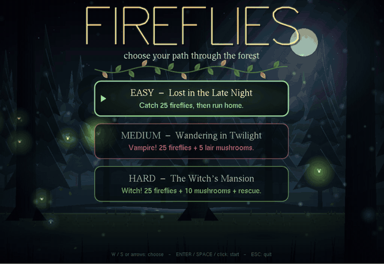

</p>


<p align="center">

  <a href="#about"><b>About</b></a> ·

  <a href="#the-three-levels"><b>Levels</b></a> ·

  <a href="#gameplay"><b>Gameplay</b></a> ·

  <a href="#gallery"><b>Gallery</b></a> ·

  <a href="#controls"><b>Controls</b></a> ·

  <a href="#how-its-built"><b>Code</b></a> ·

  <a href="#running-it"><b>Run it</b></a> ·

  <a href="#authors"><b>Authors</b></a>

</p>


## About


You are lost in a dark forest with only a net and a lantern jar. Catch fireflies and keep them in the jar: the more of them shine, the wider your circle of light grows, until the whole forest glows and you run home. On the harder levels, something is hunting you: a **vampire** in his crypt, and a **witch** who has locked ten children in a cage.


| Levels | Fireflies in the forest | Image files | Developers |

|:-:|:-:|:-:|:-:|

| **3** | **46** | **none**, everything is drawn in code | **2** |


## The three levels


| Level | Mood | Hunter | Goal |

|:--|:--|:--|:--|

| **Easy**: Lost in the Late Night | Cold blue forest night | none | Catch 25 fireflies, then run home |

| **Medium**: Wandering in Twilight | Purple and orange sky, blood moon, bats | A vampire from his crypt | Catch 25 fireflies and collect 5 lair mushrooms, then run home |

| **Hard**: The Witch's Mansion | Murky green storm night, crows, scarecrows | A witch on a broom | Catch 25 fireflies and collect lair mushrooms, then catch the 10 wisps on the cage locks to free 10 children |


## Gameplay


| **Light**<br>Every firefly in the jar widens your circle of light<br>25 fireflies make you immune to the hunter | **Hunters**<br>Jump over them or blast them back 250 px<br>A blast costs 1 lair mushroom (2 on hard) | **The way home**<br>A golden flash, a speed run, a stream crossed on stepping stones, then the cabin |

|:--|:--|:--|


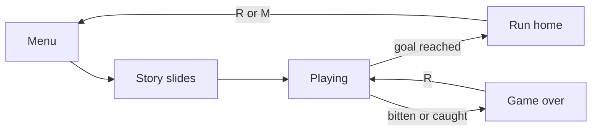


## Gallery


| 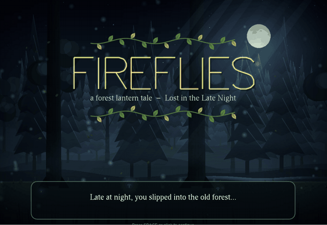<br>Easy: catching fireflies | 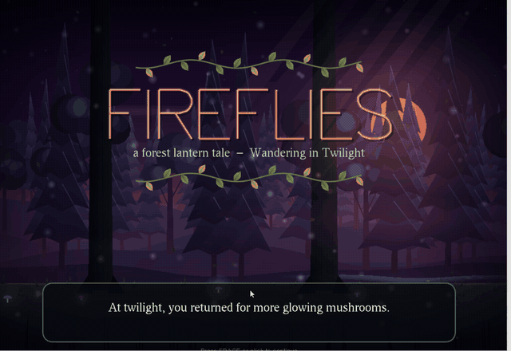<br>Medium: fireflies at twilight |

|:-:|:-:|

| 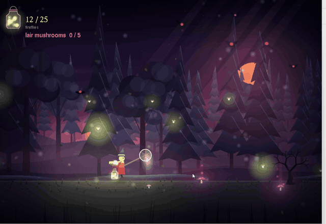<br>Collecting lair mushrooms | 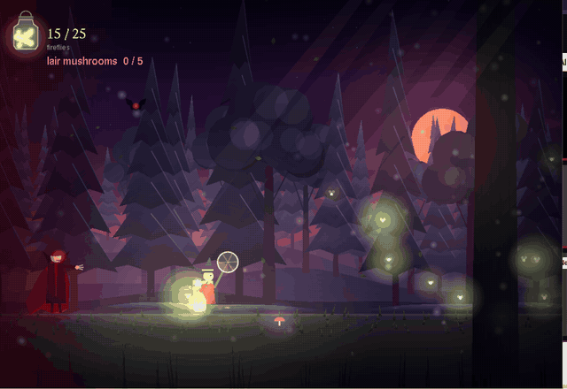<br>The vampire attacks |

| 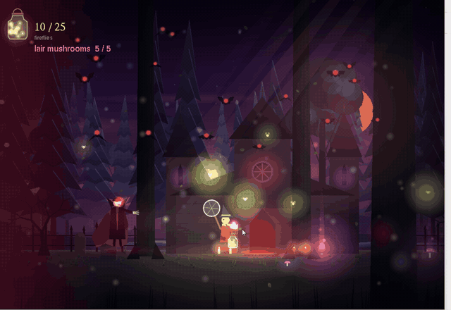<br>Mushroom blast | 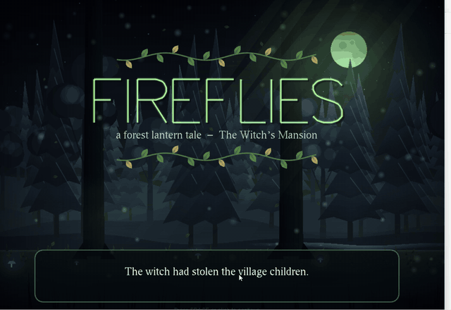<br>Hard: the witch's mansion |

| 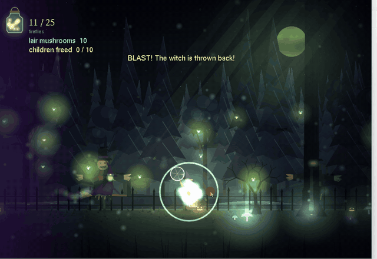<br>Blasting the witch | 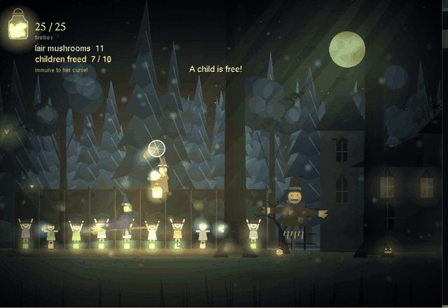<br>Freeing the children |

| 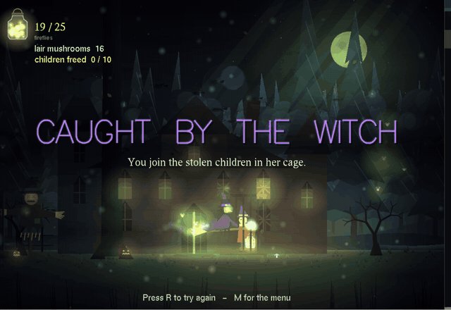<br>Game over: caught | 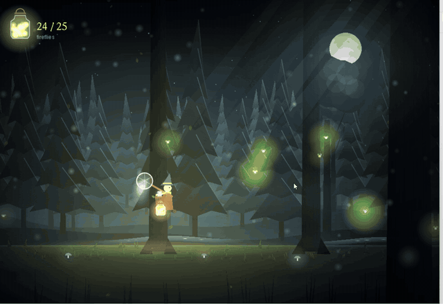<br>Home at last |


## Controls


| Key | Action |

|:--|:--|

| **A** / **D** or ← / → | Walk |

| **W** or ↑ | Hop |

| **Space** | Hop and swing the net |

| **Click the traveler** | Hop and swing the net |

| **Click anywhere else** | Swing the net only |

| **E** or **right-click** | Mushroom blast (medium and hard) |

| **R** | Restart the level |

| **M** | Back to the menu |

| **Esc** | Quit |


In the menu: **W** / **S** or ↑ / ↓ to choose, **Enter**, **Space** or click to start.


## How it's built


| Technique | Where |

|:--|:--|

| Parallax scrolling | 4 layers of hills and trees moving at different speeds |

| Additive-blend glow | Fireflies, lantern, moon, mushrooms, windows |

| A hole of light in the darkness | Triangle-strip rings around the lantern that grow with each firefly |

| Procedural scenery | Trees, grass, fog and stars from a hash function, so nothing jumps while scrolling |

| Recursive branches | The dead trees around the crypt and the mansion |

| One 1000 × 700 virtual screen | Scaled to any window size with `gluOrtho2D` |


## Project layout


```

Fireflies-A-Forest-Lantern-Game/

├── main.cpp                   the whole game

├── Forest Lantern Game.cbp    Code::Blocks project (Debug and Release targets)

├── deps/freeglut/             freeglut headers, libraries and DLL for Windows builds

├── docs/media/                banner and GIFs

├── CITATION.cff               how to cite this project

├── LICENSE

└── README.md

```


## Running it


1. Download the repository as a ZIP (green **Code** button → **Download ZIP**) and unzip it, or clone it:

   ```

   git clone https://github.com/manartouf/Fireflies-A-Forest-Lantern-Game.git

   ```

2. Install [Code::Blocks](https://www.codeblocks.org/downloads/) (the installer with **mingw** in its name).

3. Open **`Forest Lantern Game.cbp`**. If it asks which compiler to use, pick **GNU GCC Compiler**.

4. Press **F9** to build and run.


The freeglut headers, libraries and DLL are already in the repository under `deps\`, so nothing else needs to be installed.


| Problem | Fix |

|---|---|

| `GL/glut.h: No such file or directory` | the `deps` folder is missing, so unzip the whole repository again |

| "Can't find compiler executable" | install the Code::Blocks version with "mingw" in its name |

| `libfreeglut.dll was not found` when the game starts | build once with F9 (it copies the DLL by itself), or copy `deps\freeglut\bin\x64\libfreeglut.dll` into `bin\Debug` |


## Authors


| **Manar Toufique Chowdhury** | **Fahmina Zannat Khan Zebin** |

|:-:|:-:|


Made for CSE 402 (Computer Graphics &amp; Image Processing Lab) at Metropolitan University, Sylhet Bangladesh. Released under the MIT License. Uses [freeglut](https://freeglut.sourceforge.net/) for the window and input (its license is in `deps/freeglut/COPYING`).

